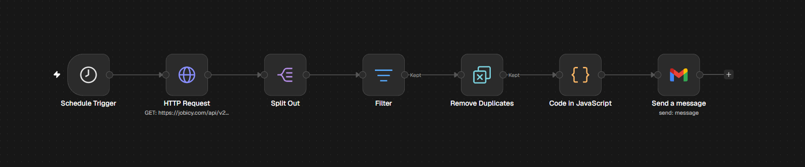

# Monitor de Novas Vagas de Emprego

Automação desenvolvida com **n8n** para monitorar oportunidades de emprego remoto no Brasil, aplicar filtros por palavras-chave, identificar vagas já processadas e enviar notificações por e-mail.

## Sobre o projeto

A busca manual por oportunidades de emprego consume tempo e pode dificultar o acompanhamento de novas vagas.
Este projeto automatiza esse processo por meio de uma integração com a API pública do Jobicy, realizando consultas programadas e selecionando oportunidades de acordo com critérios previamente definidos.

## Objetivo

- Consultar novas oportunidades de emprego.
- Filtrar vagas por palavras-chave relacionadas à área de tecnologia.
- Evitar o processamento de vagas duplicadas.
- Organizar as informações encontradas.
- Enviar um resumo das novas oportunidades por e-mail.

## Tecnologias utilizadas

- **n8n:** criação e gerenciamento do fluxo de automação.
- **Jobicy API:** fonte de dados das oportunidades de emprego.
- **HTTP Request:** comunicação com a API.
- **JavaScript:** tratamento e organização dos dados.
- **Gmail:** envio das notificações por e-mail.

### Fluxo completo

## Execução e configuração

O projeto foi desenvolvido utilizando uma instalação local do n8n executada por Docker.

Para utilizar o workflow:

1. Importe o arquivo JSON disponibilizado na pasta `workflow`.
2. Configure as credenciais necessárias para o Gmail.
3. Verifique as configurações do agendamento.
4. Execute um teste para validar a integração.
5. Ative o workflow para iniciar as consultas programadas.

**Observação:** como a execução ocorre em ambiente local, o computador e os serviços do Docker precisam permanecer ativos para que os agendamentos sejam executados.

## Fonte de dados e utilização

A automação utiliza a API pública do [Jobicy](https://jobicy.com)
